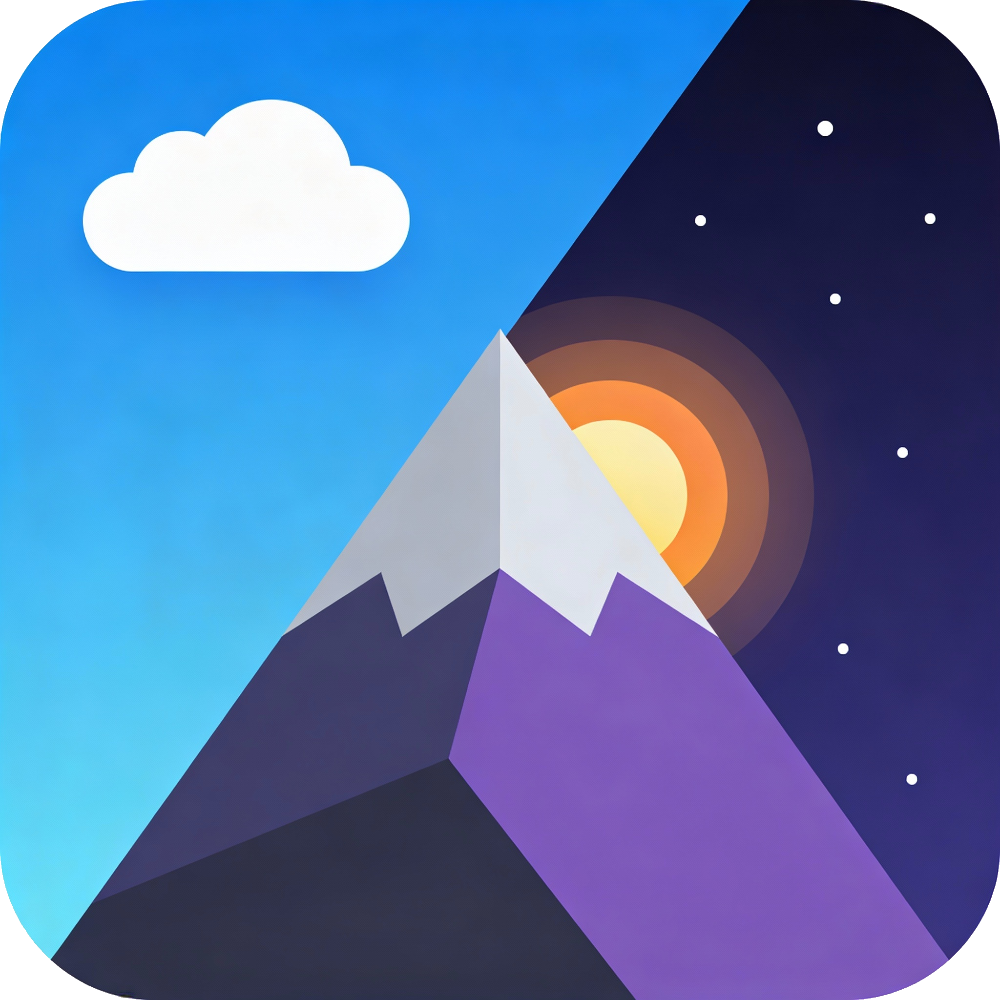
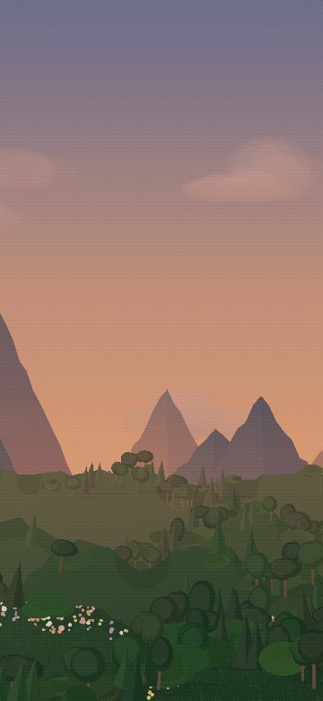
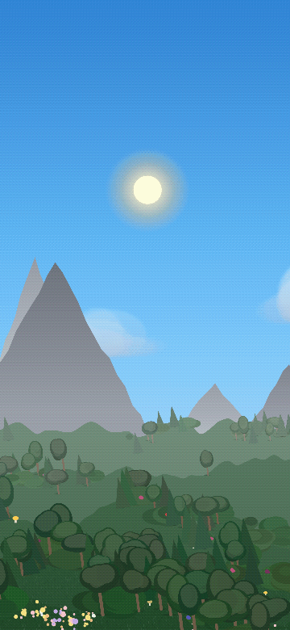
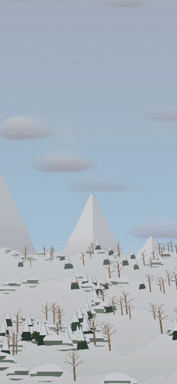
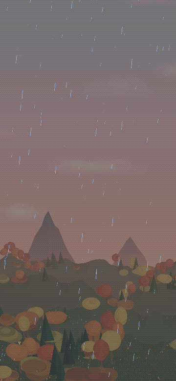
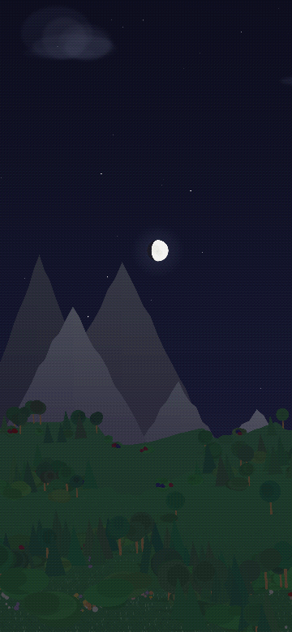

# WeatherWall

[](https://ci.olli.info/repos/4)

📥 **https://git.olli.info/Oliver/WeatherWall/releases/latest**

Android live wallpaper with a low-poly procedural landscape, weather effects, seasonal details, and gyroscope-driven parallax.

No analytics. No internet permission.

<p align="center">
  
</p>

## Screenshots

<p align="center">
  
  
  
  
  
</p>

## Features

- Procedural low-poly terrain with layered hills and mountains
- Dynamic sky with sun, moon, stars, and time-of-day lighting
- Built-in ephemeris: moon phase, Chinese New Year and the Perseids follow the real sky (accurate to minutes through 2100)
- Weather effects: rain, snow, hail, lightning, clouds
- Seasonal visuals: flowers, mushrooms, autumn leaves, snow, frost
- Seasonal events: Christmas, New Year, Chinese New Year, St. Patrick's Day
- Night-sky events: shooting stars, Perseid meteor shower, falling background stars
- Trees, bushes, rivers/lakes, animals, and random wildlife events
- Gyroscope-based parallax
- Deterministic world generation from a stable seed
- Configurable density, clustering, parallax, weather, and terrain settings
- Optimized rendering with bitmap caches and zero per-frame allocation design

## Build

Requirements:

- Android 8.0+ / API 26+
- JDK 17
- Gradle 8.13+

OR

- Docker

```bash
git clone https://git.olli.info/Oliver/WeatherWall.git
cd WeatherWall
./gradlew assembleDebug
adb install app/build/outputs/apk/debug/app-debug.apk
````

## Development

Run unit tests:

```bash
./gradlew test
```

Run lint:

```bash
./gradlew lintDebug
```

Run mutation tests:

```bash
./gradlew :app:pitest
```

### Visual renders

Event and scene artwork is reviewed from generated PNGs rather than committed images.
`event_renders/` is gitignored and is meant to be rebuilt on demand. The render tests always
render and run their assertions, but only write PNGs when `-Drender.artifacts=true` is passed:

```bash
./gradlew :app:testDebugUnitTest --tests '*EventRenderTest' --tests '*SceneScreenshotTest' -Drender.artifacts=true
```

Both tests run under Robolectric with native graphics and, with that flag, write to `event_renders/`:

| Output | Produced by | Shows |
| --- | --- | --- |
| `<Event>.png`, `<Event>_full.png` | `EventRenderTest.renderEvent` | Best single frame, cropped and full scene |
| `<Event>_f1..f3.png` | `EventRenderTest.renderFrames` | Three points across the event lifetime |
| `gait/<Event>.png` | `EventRenderTest.renderGroundAnimalGaits` | One stride sampled every 100 ms, animal kept centred |
| `scenes/`, `contact_sheets/` | `SceneScreenshotTest` | Full scenes across time of day, weather and seeds |

Use the gait sheets to judge leg motion and body attachment — the lifetime frames only show
the animal at different screen positions, never at different points of its stride.

The render suites (`EventRenderTest`, `SceneScreenshotTest`, `ReadmeScreenshotTest`,
`EventPreviewViewTest`) dominate test wall time. For a fast local loop, skip them with
`-PskipRenderTests`; CI always runs the full suite:

```bash
./gradlew :app:testDebugUnitTest -PskipRenderTests
```

### README screenshots

`docs/screenshots/` holds looping GIFs rendered through the real `ParallaxScene` with the app's
default settings while the device tilt orbits (`ReadmeScreenshotTest`). The test is skipped unless
explicitly requested:

```bash
docker compose exec dev ./gradlew testDebugUnitTest --tests '*ReadmeScreenshotTest' -Dreadme.screenshots=true
```

## Docker

Build the CI image:

```bash
docker compose build build
```

Run tests in Docker:

```bash
docker compose run --rm build ./gradlew test --no-daemon
```

For repeated runs, keep a container with a warm Gradle daemon:

```bash
docker compose up -d dev
docker compose exec dev ./gradlew testDebugUnitTest
```

Run mutation tests in Docker:

```bash
docker compose run --rm build ./gradlew :app:pitest --no-daemon
```
